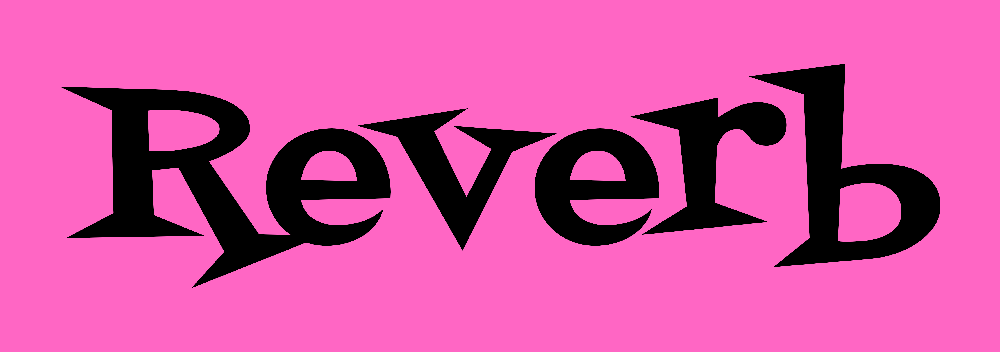

<p align="center">
  
</p>

<h1 align="center">Reverb</h1>

<p align="center">
  <a href="https://github.com/CodeSuthar/Reverb/releases">
    
  </a>
  <a href="https://github.com/CodeSuthar/Reverb/blob/main/LICENSE">
    
  </a>
  <a href="https://nodejs.org/">
    
  </a>
  <a href="https://discord.js.org/">
    
  </a>
  <a href="https://nodelink.js.org/">
    
  </a>
  <a href="https://moonlink.js.org/">
    
  </a>
  <a href="https://discord.com/oauth2/authorize?client_id=1558414328456020028&permissions=281891692735824&integration_type=0&scope=bot+applications.commands">
    
  </a>
  <a href="https://discord.gg/6UwVYHu2zu">
    
  </a>
</p>

<p align="center">
  <b>Reverb</b> is a modern, high-fidelity Discord music bot built with <b>discord.js v14</b>, <b>Moonlink.js</b>, and <b>NodeLink</b>.
  <br>
  Engineered for ultra-low latency audio streaming, rich interactive controls, and multi-engine database persistence.
</p>

<p align="center">
  <a href="https://discord.com/oauth2/authorize?client_id=1558414328456020028&permissions=281891692735824&integration_type=0&scope=bot+applications.commands">
    </img>
  </a>
  &nbsp;&nbsp;
  <a href="https://discord.gg/6UwVYHu2zu">
    
  </a>
</p>

---

## 🤖 Official Bot & Community Support

Prefer not to self-host? You can invite the **Official Reverb Bot** directly to your Discord server or join our official community support server!

- 🔗 **Official Bot Invite:** [Click Here to Invite Reverb](https://discord.com/oauth2/authorize?client_id=1558414328456020028&permissions=281891692735824&integration_type=0&scope=bot+applications.commands)  
- 💬 **Support Server:** [discord.gg/6UwVYHu2zu](https://discord.gg/6UwVYHu2zu)
---

## 🌟 Key Features

- ⚡ **NodeLink & Lavalink Dual-Engine**: Natively optimized for **[NodeLink](https://nodelink.js.org/)** (100% pure Node.js, zero Java requirement, built-in sources for 15+ streaming platforms) while retaining full compatibility with **[Lavalink v4](https://lavalink.dev/)**.
- 🌙 **Powered by Moonlink.js**: Sub-second track dispatch, intelligent reconnects, stalled track recovery, and dynamic least-load node balancing.
- 🎛️ **59 Dual-Compatible Commands**: Seamless parity across message prefix commands (e.g. `r!play`) and Discord slash commands (e.g. `/play`).
- 📻 **Dedicated Song Requests Channel**: Turn any text channel into an interactive music station (`r!setup create` / `/setup create`) with a persistent, real-time auto-updating player card.
- 📂 **Personal Custom Playlists**: Save tracks with public or private visibility, unclonable private playlists, and secure DM delivery.
- 🛡️ **DJ Protection & Whitelisting**: Granular authority over DJ roles, DJ users, and auto-deleting channel restriction warnings.
- 🎧 **Hardware Audio Filters**: Real-time DSP audio manipulation including 8D, Bassboost, Nightcore, Vaporwave, Tremolo, Vibrato, and 15-band graphic equalization.
- 💾 **Multi-Engine Database Support**: Zero-config SQLite (`better-sqlite3`), MongoDB (`mongoose`), PostgreSQL, and MySQL (`drizzle-orm`).

---

## 🚀 Quick Start

### 1. Prerequisites
- **Node.js**: `>= 18.17.0` (Recommended: `v22.x LTS`)
- **Package Manager**: `pnpm`, `npm`, or `yarn`
- **Audio Server**: **[NodeLink](./docs/getting-started/nodelink-setup.md)** *(Recommended, pure Node.js)* or **[Lavalink v4](./docs/getting-started/lavalink-setup.md)** *(Requires Java 17/21)*

### 2. Clone the Repository
```bash
git clone https://github.com/CodeSuthar/Reverb.git
cd Reverb
```

### 3. Install Dependencies
Choose your preferred package manager:

```bash
# Option A: pnpm (Recommended)
pnpm install

# Option B: npm
npm install

# Option C: yarn
yarn install
```

### 4. Configure Environment
Copy the example environment file:
```bash
# On Linux / macOS:
cp .env.example .env

# On Windows (PowerShell):
Copy-Item .env.example .env
```

Open `.env` and fill in your Discord credentials:
```dotenv
CLIENT_ID="your_discord_application_id"
CLIENT_SECRET="your_discord_client_secret" # For upcoming web dashboard
CLIENT_TOKEN="your_discord_bot_token"
DATABASE_PROVIDER=sqlite
```

### 5. Launch NodeLink (Audio Node)
If using NodeLink:
```bash
git clone https://github.com/PerformanC/NodeLink.git
cd NodeLink
npm install
cp config.default.js config.js
npm start
```

### 6. Start Reverb
```bash
# Option A: pnpm
pnpm start

# Option B: npm
npm start

# Option C: yarn
yarn start
```

---

## 📖 Complete Documentation

Comprehensive guides, architectural diagrams, command lists, and troubleshooting steps are available in the **[Documentation Hub](./docs/README.md)**:

- 🚀 **[System Prerequisites](./docs/getting-started/prerequisites.md)**
- 🤖 **[Discord Developer Portal Setup](./docs/getting-started/discord-portal.md)** *(Permission Bit: `281891692735824`)*
- ⚡ **[NodeLink Audio Server Setup](./docs/getting-started/nodelink-setup.md)** *(Recommended)*
- 🌙 **[Moonlink.js Client Library Guide](./docs/getting-started/moonlink.md)**
- 🔊 **[Lavalink v4 Setup Guide](./docs/getting-started/lavalink-setup.md)** *(Alternative)*
- 📜 **[Command Reference (All 59 Commands)](./docs/features/commands-guide.md)**
- 🏗️ **[System Architecture & Lifecycle](./docs/architecture/overview.md)**
- ⚡ **[Event Dispatching & Music Events](./docs/architecture/events.md)**
- 🩺 **[Troubleshooting & FAQ](./docs/troubleshooting/faq.md)**

---

## 📜 The Reverb Story & Transparency

Reverb has a history, and we believe in complete transparency and accountability regarding why the bot was created, past lessons learned, and why it was revived as a 100% open-source project.

👉 **Read the full developer story and roadmap in [The Reverb Story](./docs/about/story.md).**

---

## 🛠️ Tech Stack

| Technology | Purpose |
| :--- | :--- |
| **[discord.js v14](https://discord.js.org/)** | Discord Gateway & REST client |
| **[NodeLink](https://nodelink.js.org/)** | High-performance 100% Node.js audio streaming daemon |
| **[Moonlink.js](https://moonlink.js.org/)** | Next-generation audio client driver & queue manager |
| **[better-sqlite3](https://github.com/WiseLibs/better-sqlite3)** | Blazing-fast embedded local database storage |
| **[Drizzle ORM](https://orm.drizzle.team/)** | Type-safe SQL migrations for PostgreSQL & MySQL |
| **[Mongoose](https://mongoosejs.com/)** | Document persistence for MongoDB clusters |
| **[LRCLIB](https://lrclib.net/)** | Synchronized lyrics integration |

---

## 🤝 Contributing

Contributions are welcome! If you encounter bugs, have feature ideas, or want to contribute optimizations:
1. Fork the repository.
2. Create your feature branch (`git checkout -b feature/amazing-feature`).
3. Commit your changes (`git commit -m 'Add amazing feature'`).
4. Push to the branch (`git push origin feature/amazing-feature`).
5. Open a Pull Request.

---

## 📄 License & Disclaimers

Reverb is an independent, community-driven open-source project licensed under the **[Apache 2.0 License](LICENSE)**.

Copyright © 2026 — maintained by <span style="color: #FF66C4; font-weight: 600;">The Reverb Team</span> and <a href="https://github.com/CodeSuthar" target="_blank" rel="noopener noreferrer" style="color: #FF66C4; font-weight: 600;">CodeSuthar</a>.

*Disclaimer: Reverb is not affiliated with, sponsored by, or endorsed by Discord, Spotify, YouTube, SoundCloud, Apple Music, Deezer, or Bandcamp.*
