# ⚡ Event Dispatching & Music Events

[🏠 Documentation Hub](../README.md) > [Architecture](./overview.md) > **Events System**

Reverb uses an event-driven architecture that separates **Discord Gateway Client Events** from **Moonlink Audio Streaming Events**.

---

## 1. Event Flow Architecture

```mermaid
flowchart TD
    subgraph DiscordEvents["Discord Gateway Client Events (src/events/)"]
        ClientReady["clientReady.js\n(Registers slash commands, inits Moonlink)"]
        Raw["raw.js\n(Feeds voice server packets to Moonlink)"]
        MsgCreate["messageCreate.js\n(Prefix dispatch, whitelist, DJ check)"]
        IntCreate["interactionCreate.js\n(Slash commands, autocomplete)"]
        SetupBtn["setupButtons.js\n(Interactive player card buttons)"]
        SetupSys["setupSystem.js\n(Direct text-to-song in setup channel)"]
    end

    subgraph MoonlinkEvents["Moonlink Audio Events (src/events/music/)"]
        subgraph NodeEvents["Node Events (music/node/)"]
            NodeConn["nodeConnected.js"]
            NodeReady["nodeReady.js"]
            NodeDisc["nodeDisconnect.js"]
            NodeErr["nodeError.js"]
        end

        subgraph PlayerEvents["Player Events (music/player/)"]
            PlayerCreate["playerCreate.js"]
            PlayerPause["playerPause.js"]
            PlayerVolume["playerChangedVolume.js"]
            FiltersUp["filtersUpdate.js"]
            PlayerDestroy["playerDestroy.js"]
        end

        subgraph TrackEvents["Track Events (music/track/)"]
            TrackStart["trackStart.js\n(Voice status, player card update)"]
            TrackEnd["trackEnd.js\n(Cleans previous track card)"]
        end

        subgraph QueueEvents["Queue Events (music/queue/)"]
            QueueAdd["queueAdd.js\n(Updates up-next list)"]
            QueueRemove["queueRemove.js"]
            QueueEnd["queueEnd.js\n(Resets player card to idle)"]
        end
    end

    Raw --> NodeConn
    MsgCreate --> TrackStart
    IntCreate --> TrackStart
    SetupSys --> QueueAdd
    SetupBtn --> PlayerPause
```

---

## 2. Discord Gateway Events (`src/events/`)

Gateway events listen directly to discord.js `client.on(event.name, ...)` and are loaded by `src/handler/clientEvents.js`:

### 🌐 Client Subsystem (`src/events/client/`)
| Event File | Discord Event | Responsibility |
| :--- | :--- | :--- |
| **`clientReady.js`** | `clientReady` | Logs login success, displays ASCII banner, initializes Moonlink client with `client.user.id`, restores 24/7 connections, and registers slash commands. |
| **`raw.js`** | `raw` | Intercepts low-level Discord voice gateway payloads (`VOICE_SERVER_UPDATE`, `VOICE_STATE_UPDATE`) and passes them into Moonlink's packet handler. |

### 💬 Command Subsystem (`src/events/commands/`)
| Event File | Discord Event | Responsibility |
| :--- | :--- | :--- |
| **`messageCreate.js`** | `messageCreate` | Resolves prefix commands, verifies bot channel permissions, checks channel whitelists (auto-deleting warnings after 8s), enforces DJ authorization, and executes message commands. |
| **`interactionCreate.js`** | `interactionCreate` | Handles Slash Command execution, subcommand routing, permission validation, and ephemeral error responses. |
| **`autoComplete.js`** | `interactionCreate` (Autocomplete) | Powers live search suggestions for commands (e.g. searching playlists or filter names). |

### 📻 System & Song Requests Subsystem (`src/events/system/`)
| Event File | Discord Event | Responsibility |
| :--- | :--- | :--- |
| **`setupButtons.js`** | `interactionCreate` (Button) | Intercepts button clicks on the persistent player view (`player_pause`, `player_skip`, `player_stop`, `player_loop`, etc.), verifies same voice channel and DJ permissions. |
| **`setupSystem.js`** | `messageCreate` | Intercepts plain text or song links sent into the `#reverb-song-requests` channel, auto-deletes the prompt, and queues the track. |

---

## 3. Moonlink Audio Streaming Events (`src/events/music/`)

Loaded dynamically by `reverbManager` from `src/events/music/`:

### 🔌 Node Lifecycle (`src/events/music/node/`)
- **`nodeConnected.js`**: Fired when the WebSocket handshake with NodeLink or Lavalink succeeds. Checks and re-establishes active 24/7 guild sessions.
- **`nodeReady.js`**: Fired when the audio server signals readiness to handle audio players.
- **`nodeDisconnect.js`**: Triggered when the node connection drops; schedules reconnection.
- **`nodeError.js`**: Captures and logs socket communication errors.
- **`nodeReconnect.js` / `nodeReconnecting.js`**: Handles exponential backoff reconnect attempts.
- **`nodeResume.js` / `nodeCreate.js` / `nodeDestroy.js`**: Tracks node cluster lifecycle.

### 🎛️ Player Lifecycle (`src/events/music/player/`)
- **`playerCreate.js`**: Emitted when a new guild audio player is instantiated.
- **`playerDestroy.js`**: Cleans up guild player data and resets channel voice status.
- **`playerPause.js`**: Synchronizes interactive button states when music is paused/resumed.
- **`playerChangedVolume.js`**: Fires when volume is adjusted.
- **`playerChangedLoop.js`**: Synchronizes loop indicators (`track`, `queue`, `off`).
- **`filtersUpdate.js`**: Logs DSP equalizer and timescale filter changes.

### 🎵 Track Lifecycle (`src/events/music/track/`)
- **`trackStart.js`**:
  1. Sets Discord voice channel status (`🎵 • Song Title`).
  2. Sends Now Playing card in the active text channel.
  3. Updates the persistent player view in `#reverb-song-requests`.
- **`trackEnd.js`**:
  1. Cleans up previous track card from chat.
  2. Resets voice channel status when playback terminates.
  3. Updates persistent player card.

### 📜 Queue Lifecycle (`src/events/music/queue/`)
- **`queueAdd.js`**: Fired when new tracks are queued; immediately refreshes the up-next list in the setup view.
- **`queueRemove.js`**: Fired when a track is removed or moved in the queue.
- **`queueEnd.js`**: Fired when the last track in the queue finishes. If 24/7 mode is not enabled, starts the idle disconnect countdown.

---

## ⏭️ Next Step

Proceed to **[Frequently Asked Questions](../troubleshooting/faq.md)** or the **[Error Solutions Guide](../troubleshooting/errors.md)**.
