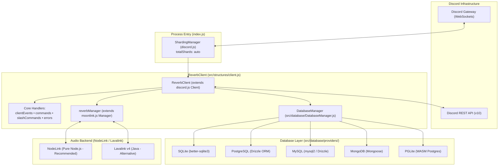
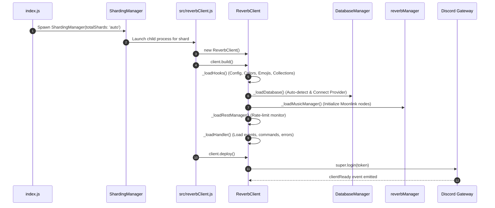
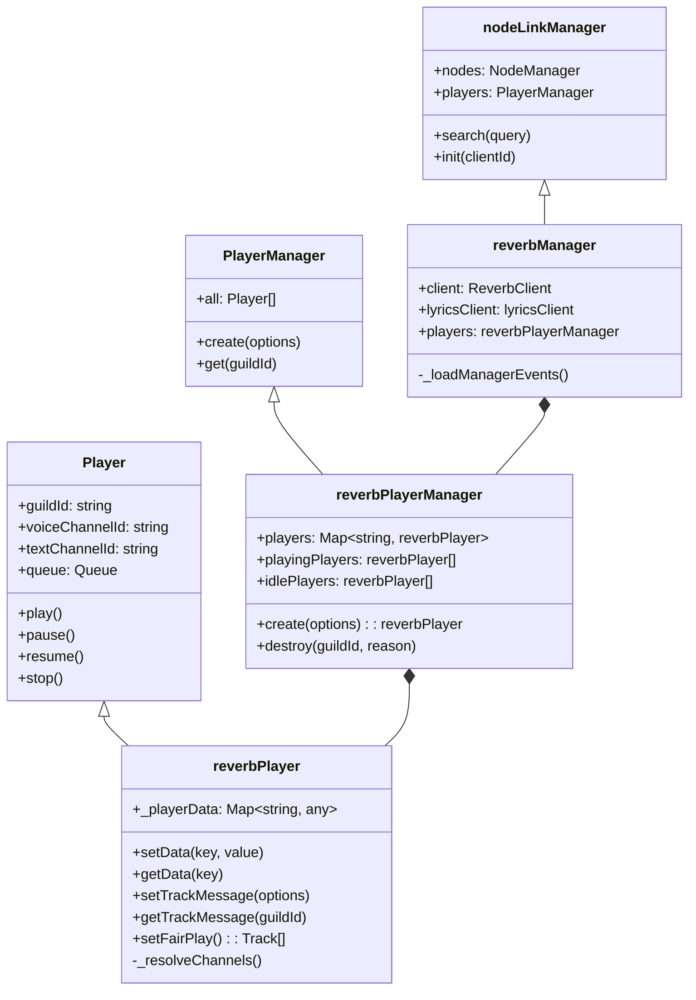

# 🏗️ System Architecture & Lifecycle

[🏠 Documentation Hub](../README.md) > **Architecture Overview**

This guide provides an accurate, code-accurate technical walkthrough of Reverb's internal architecture, component hierarchies, initialization sequence, and data flow.

---

## 1. Architectural Topology

Reverb separates Discord gateway processing, audio node communication, database operations, and command dispatching into clean, modular tiers:

---

## 2. Boot & Initialization Lifecycle

When running `npm start`, `pnpm start`, or `yarn start`, Reverb executes through a defined lifecycle:

### Lifecycle Steps in Detail:
1. **Sharding Initialization (`index.js`)**:
   Creates a `ShardingManager` targeting `./src/reverbClient.js` with `totalShards: "auto"`. Shards are automatically spawned and managed.
2. **Configuration & Hooks (`_loadHooks`)**:
   Loads `config.reverb.js`, initializes in-memory Discord `Collection` instances for prefix commands, aliases, and slash commands, and calculates brand hex/integer colors.
3. **Database Connection (`_loadDatabase`)**:
   Instantiates `DatabaseManager`, detects the configured driver (`sqlite`, `mongodb`, `postgresql`, `mysql`, or `pglite`), connects to the database, and initializes table schemas.
4. **Music Manager (`_loadMusicManager`)**:
   Instantiates `reverbManager` (extending Moonlink's `Manager`), registers audio cluster nodes from `config.reverb.js`, and sets up LRCLIB lyrics client.
5. **REST Rate-Limit Monitor (`_loadRestManager`)**:
   Listens to `client.rest.on("rateLimited")` to log rate-limit headers and prevent thread starvation.
6. **Core Handlers (`_loadHandler`)**:
   Dynamically loads the 4 core handlers: `clientEvents`, `commands`, `slashCommands`, and `errors`.
7. **Gateway Login (`client.deploy()`)**:
   Authenticates with the Discord Gateway using `bot.token`. Once connected, the `clientReady` event initializes Moonlink with `client.user.id` and registers application slash commands.

---

## 3. Audio Pipeline & Player Hierarchy

Reverb's audio management extends Moonlink.js with specialized managers:

### Key Audio Classes:
- **`reverbManager`** (`src/structures/reverbManager.js`):
  Extends Moonlink.js `Manager`. Configures node failover (`leastLoad`), auto-destruction on idle, stuck track detection, LRCLIB integration, and dynamically registers all events from `src/events/music/`.
- **`reverbPlayerManager`** (`src/structures/reverbPlayerManager.js`):
  Extends Moonlink.js `PlayerManager`. Manages player lifecycles, player collections, bulk disconnections, and creates instances of `reverbPlayer`.
- **`reverbPlayer`** (`src/structures/reverbPlayer.js`):
  Extends Moonlink.js `Player`. Adds custom guild data caching, persistent track message tracking (`setTrackMessage`), channel resolution, and the round-robin fairplay queue algorithm (`setFairPlay`).

---

## 4. Multi-Driver Database Architecture

Reverb uses an abstracted Repository pattern managed by `DatabaseManager` (`src/database/DatabaseManager.js`):

```mermaid
flowchart LR
    AppCore["Commands & Events"] --> DBManager["DatabaseManager (Facade API)"]

    subgraph Repositories["Domain Repositories"]
        R1["guildRepository"]
        R2["djRepository"]
        R3["stayRepository (24/7)"]
        R4["playlistRepository"]
        R5["setupRepository"]
        R6["whitelistRepository"]
        R7["botRepository"]
    end

    subgraph Providers["Storage Providers"]
        P1["SQLiteProvider (better-sqlite3)"]
        P2["PostgresProvider (Drizzle ORM)"]
        P3["MySQLProvider (Drizzle ORM)"]
        P4["MongoProvider (Mongoose)"]
        P5["PGLiteProvider (WASM PostgreSQL)"]
    end

    DBManager --> Repositories
    Repositories --> Providers
```

- **Agnostic Persistence**: Commands interact with unified async methods (e.g. `client.database.getDJ(guildId)` or `client.database.getWhitelist(guildId)`).
- **Auto-Migration**: Relational providers (SQLite, PostgreSQL, MySQL, PGLite) automatically execute `CREATE TABLE IF NOT EXISTS` and self-healing `ALTER TABLE` migrations on boot.

---

## 5. Core Handler Subsystems

Loaded via `_loadHandler()` from `src/handler/`:

| Handler | Source File | Functionality |
| :--- | :--- | :--- |
| **`clientEvents`** | `src/handler/clientEvents.js` | Recursively reads non-music event folders (`client`, `commands`, `system`) and binds handlers to `client.on(event.name, ...)`. |
| **`commands`** | `src/handler/commands.js` | Recursively reads `src/commands/messages/`, registers commands and aliases into `client.commands` and `client.aliases`. |
| **`slashCommands`** | `src/handler/slashCommands.js` | Recursively reads `src/commands/slash/`, registers commands into `client.slashCommands`, and handles global/dev deployment via Discord REST. |
| **`errors`** | `src/handler/errors.js` | Catches global uncaught exceptions, unhandled promise rejections, and Discord REST errors to prevent bot crashes. |

---

## ⏭️ Next Step

Explore how events are routed through Reverb in **[Event Dispatching & Music Events](./events.md)**.
