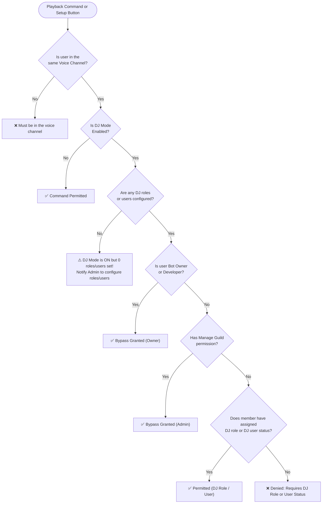

# 🛠️ Guild Customization, DJ & Whitelist System

[🏠 Documentation Hub](../README.md) > [Features](./music-system.md) > **Customization & DJ**

Reverb provides server administrators with powerful customization controls to tailor the bot's appearance, secure playback management, and restrict commands to designated channels.

---

## 1. Live Bot Customization (`r!customise` / `/customise`)

The `customise` command allows administrators to change how Reverb presents itself in the server in real time:

```text
r!customise
# or
/customise
```

### Server Nickname Modification
Administrators can run:
```text
r!customise nick [New Name]
```
- **Dynamic Discord API Integration**: Reverb updates its server-specific profile nickname immediately without altering its global bot user identity.
- **Resetting to Default**: Running `r!customise nick` with no argument clears the custom nickname, restoring the default name `Reverb`.

---

## 2. Guild Prefix Configuration (`r!setprefix`)

By default, Reverb responds to the prefix specified in `config.reverb.js` (`bot.prefix`, default: `"r!"`).

Administrators can set a custom prefix per guild:
```text
r!setprefix <new_prefix>
```
*Example:*
```text
r!setprefix re!
```

- Stored permanently in the database.
- Cached in memory so command execution remains instantaneous without querying the database on every message.
- Reset anytime with `r!setprefix r!` (or `r!setprefix reset`).

::: tip Prefix Flexibility
Even if a custom prefix is configured, users can always trigger commands by **mentioning the bot** (e.g. `@Reverb play song title`) or by using **Slash Commands** (`/play`).
:::

---

## 3. DJ Protection System (`r!dj` / `/dj`)

In public or large Discord servers, allowing any user to pause, skip, or clear the music queue can lead to griefing. Reverb's DJ system solves this by allowing server administrators to grant DJ privileges to specific **Roles** and/or individual **Users**:

### Commands
```text
r!dj toggle                        - Enables or disables DJ Mode in the server
r!dj add <@role|@user|id|name>     - Adds a role or user as an authorized DJ
r!dj remove <@role|@user|id|name>  - Removes a role or user from the DJ list
r!dj role add/remove/clear <@role> - Manages DJ roles specifically
r!dj user add/remove/clear <@user> - Manages DJ users specifically
r!dj list                          - Displays the current DJ Mode and all registered DJ roles & users
r!dj clear [roles|users|all]       - Clears configured DJ roles, DJ users, or all DJ configurations
```

Slash command `/dj` supports dedicated subcommands: `add`, `remove`, `role`, `user`, `toggle`, `list`, and `clear`.

### DJ Verification Algorithm
When DJ Mode is enabled, any command modifying playback or audio filters checks the following authorization hierarchy:



::: warning Multi-Platform Consistency
Message commands, slash commands, and interactive buttons on the song-requests setup view follow this identical verification logic.
:::

---

## 4. Command Whitelist & Channel Lockdown (`r!whitelist` / `/whitelist`)

To keep busy chat channels (like `#general`) clean from bot commands, administrators can lock command usage to designated bot channels while granting bypass privileges to trusted roles or users:

### Commands
```text
r!whitelist toggle                       - Enables or disables channel restriction mode
r!whitelist add <#channel|@role|@user>   - Adds an allowed channel or bypass role/user
r!whitelist remove <#channel|@role|@user>- Removes a channel or bypass role/user
r!whitelist channel add/remove/clear     - Manage authorized command channels
r!whitelist role add/remove/clear        - Manage roles allowed anywhere
r!whitelist user add/remove/clear        - Manage users allowed anywhere
r!whitelist list                         - View active whitelist rules
r!whitelist clear [channels|roles|users|all] - Reset whitelist settings
```

::: info Auto-Deleting Warnings
When a non-whitelisted user attempts to run a command in an unauthorized channel, Reverb replies with a warning embed listing the allowed channels and automatically deletes the message after a few seconds to prevent chat clutter.
:::

---

## ⏭️ Next Step

Understand the codebase design and component hierarchies in **[System Architecture & Lifecycle](../architecture/overview.md)**.
