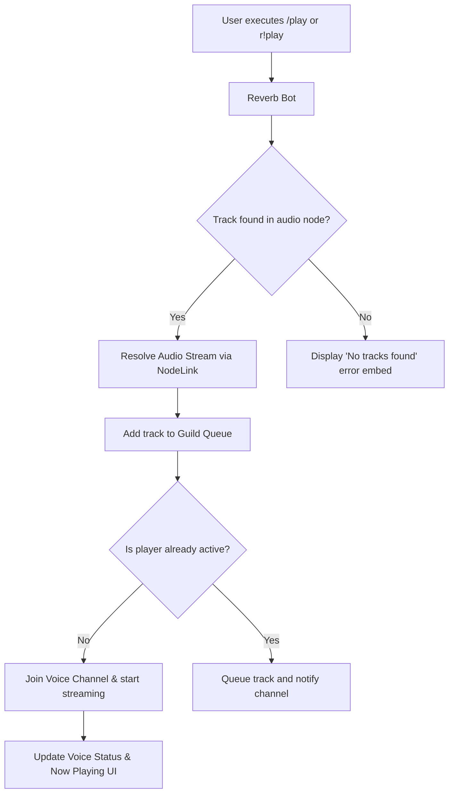
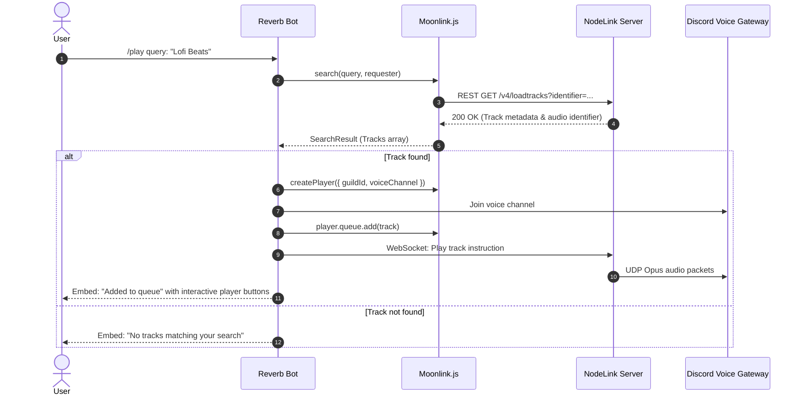

# 🎵 Music Engine & Audio Pipeline

[🏠 Documentation Hub](../README.md) > [Features](./music-system.md) > **Music Engine**

Reverb's audio architecture is built on top of **[Moonlink.js](../getting-started/moonlink.md)**, communicating with your audio server (**[NodeLink](../getting-started/nodelink-setup.md)** or **[Lavalink v4](../getting-started/lavalink-setup.md)**) over high-throughput WebSockets. It delivers sub-second track dispatching, real-time volume interpolation, dynamic audio filters, intelligent autoplay, and synchronized lyrics.

---

## 1. Supported Audio Sources

Reverb supports resolving audio tracks from:
- **YouTube Music** (`youtubemusic` platform)
- **YouTube Standard** (direct video, channel, or playlist URLs)
- **Spotify** (Tracks, Playlists, Albums)
- **SoundCloud** (`soundcloud` platform)
- **Apple Music**
- **Deezer**
- **Bandcamp**
- **Twitch & Direct HTTP Audio Streams**

::: tip Native Sources with NodeLink
When using NodeLink, all the sources above are natively supported out-of-the-box without requiring external Java plugins or maven downloads.
:::

---

## 2. Advanced Audio Filters

Reverb provides direct hardware-accelerated DSP filters applied in real-time through the audio node:

| Command | Filter Applied | Effect Description |
| :--- | :--- | :--- |
| `r!bassboost [level]` | Equalizer (Low bands) | Multiplies 20Hz - 125Hz gain up to +5dB for punchy low-end response. |
| `r!nightcore` | Timescale (`speed: 1.2`, `pitch: 1.2`) | Accelerates track tempo and raises musical pitch. |
| `r!vaporwave` | Timescale (`speed: 0.85`, `pitch: 0.8`) | Slows tempo and drops pitch for an atmospheric retro feel. |
| `r!8d` | Rotation (`hertz: 0.2`) | Pans stereo audio smoothly between left and right ears. |
| `r!tremolo` | Tremolo (`depth: 0.5`, `frequency: 2.0`) | Rapidly modulates volume for a fluttering sound. |
| `r!vibrato` | Vibrato (`depth: 0.5`, `frequency: 2.0`) | Rapidly modulates pitch. |
| `r!speed <value>` | Timescale (`speed: value`) | Adjusts playback speed without modifying musical pitch. |
| `r!pitch <value>` | Timescale (`pitch: value`) | Transposes song key up or down. |
| `r!clearfilters` | Reset | Clears all active DSP audio filters back to neutral. |

---

## 3. Intelligent Autoplay

When enabled via `r!autoplay` or `/autoplay`, Reverb monitors queue depletion. When the last user-queued song finishes playing:
1. Reverb queries for related recommendations based on the ID of the last played song.
2. It deduplicates against previously played history in the session.
3. It enqueues the top-ranked recommendation automatically, ensuring uninterrupted music playback 24/7.

---

## 4. Voice Channel Dynamic Status

When a track begins playing, Reverb updates the Discord voice channel status to display:
```text
🎵 • <Song Title>
```
When playback stops or the player disconnects, Reverb cleans the voice status back to empty.

---

## 5. Synchronized Lyrics Integration

Reverb integrates **LRCLIB** (`lrclib-api`), an open, crowd-sourced synchronized lyrics database:
- Executing `r!lyrics` or `/lyrics` queries LRCLIB for the current playing song.
- If synced lyrics are found, Reverb renders formatted verses inside a clean, high-contrast message card.

---

## 6. Track Playback Lifecycle & Architecture

The following diagrams illustrate how Reverb resolves, schedules, and streams audio tracks through Moonlink.js and NodeLink:

### Playback Decision Flow



### Audio Dispatch Sequence



---

## ⏭️ Next Step

Read about Reverb's dedicated interactive music channel in **[Dedicated Song Requests Channel](./setup-channel.md)**.
